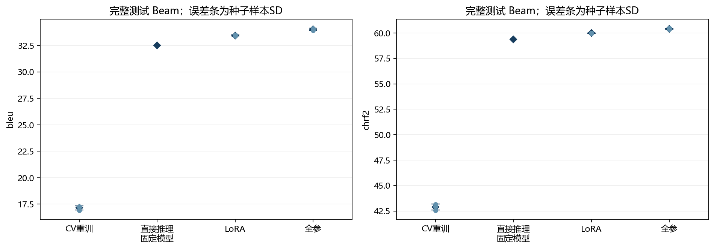

# IWSLT-17 英德机器翻译

[模型下载 — v1.1.0](https://github.com/lermitto1221/iwslt-en-de-translation/releases/tag/v1.1.0) · [English](README.md) · [实验结果](docs/RESULTS.md) · [CV 与适配研究](docs/CV_ADAPTATION.md) · [复现说明](docs/REPRODUCING.md) · [第三方来源](docs/THIRD_PARTY.md)

[](https://github.com/lermitto1221/iwslt-en-de-translation/actions/workflows/tests.yml)

基于 PyTorch 的英→德机器翻译项目，重点是控制变量、结果稳定性与错误分析。项目从零训练小型 Transformer，使用三个随机种子研究训练预算和子词表示，完成分组交叉验证调参，并比较同一 OPUS-MT 底座的直接推理、LoRA 与全参数微调。

## 下载适配模型并试译

[v1.1.0 Release](https://github.com/lermitto1221/iwslt-en-de-translation/releases/tag/v1.1.0) 分别提供全参和 LoRA 推理包，均自带 `translate.py`、`inference.py`、固定版本依赖、原生分词器与配置及使用说明。**无需克隆源码仓库、下载训练数据或重新训练。** 下列 MB 使用十进制计量。

| 下载 | ZIP 大小 | seed42 单模型测试 Beam BLEU | 运行条件 |
|---|---:|---:|---|
| [全参数微调 ZIP](https://github.com/lermitto1221/iwslt-en-de-translation/releases/download/v1.1.0/iwslt-en-de-full-seed42-inference-v1.1.0.zip) · [SHA-256](https://github.com/lermitto1221/iwslt-en-de-translation/releases/download/v1.1.0/iwslt-en-de-full-seed42-inference-v1.1.0.zip.sha256) | **277.6 MB** | **33.924** | 包含完整权重，安装依赖后可离线翻译 |
| [LoRA ZIP](https://github.com/lermitto1221/iwslt-en-de-translation/releases/download/v1.1.0/iwslt-en-de-lora-seed42-inference-v1.1.0.zip) · [SHA-256](https://github.com/lermitto1221/iwslt-en-de-translation/releases/download/v1.1.0/iwslt-en-de-lora-seed42-inference-v1.1.0.zip.sha256) | **2.34 MB** | **33.402** | 首次运行下载约 298 MB 的固定原始底座权重 |

建议先试用全参包。下载全参 ZIP 后，对照 `.sha256` 校验文件；使用 Python 3.13，在 ZIP 所在目录的 Windows PowerShell 中运行：

```powershell
Expand-Archive -LiteralPath .\iwslt-en-de-full-seed42-inference-v1.1.0.zip -DestinationPath .\models
Set-Location .\models\full_seed42
python -m venv .venv
.\.venv\Scripts\python.exe -m pip install -r requirements.txt
.\.venv\Scripts\python.exe translate.py --device cpu --method beam --offline --text "Thank you very much."
```

LoRA ZIP 解压得到 `lora_seed42`，按包内 README 执行相同安装步骤；首次试译去掉 `--offline`，允许下载固定底座。已有原始底座时可使用 `--base-model-dir PATH --offline`，运行时会核验模型、revision 和权重 SHA-256。该格式由本项目实现，**不是 PEFT adapter**；2.34 MB ZIP 不代表全部部署体积。

全参／LoRA 下载包的 seed42 成绩分别为 **33.924／33.402**。下文 **34.032 ± 0.094／33.450 ± 0.052** 是三个种子的均值±样本标准差，不是这两个单模型或集成模型的成绩。记录的测试分数来自原 FP32／GPU 协议，CPU 导出检查不承诺跨硬件逐位一致。超过 512 个原生源 token 的输入会被拒绝，不静默截断；翻译错误仍存在。

### 原小型模型试译

[v1.0.0 Release](https://github.com/lermitto1221/iwslt-en-de-translation/releases/tag/v1.0.0) 继续保留 43.5 MB 的从零训练 seed42／12,000 步模型包，单模型 **22.889 Beam BLEU**；其研究中的 **23.137 ± 0.321** 为三种子均值。安装本源码仓库依赖并将旧包解压到 `models` 后，原命令仍可使用：

```powershell
python -m mt.translate --bundle .\models\quality_A42_12000 --device cpu --method beam --text "Thank you very much."
```

v1.1.0 适配模型使用包内独立的 `translate.py` 入口。统计口径和局限见[结果说明](docs/RESULTS.md)。

## 主要结果

以下均在完整 **8,079 句 IWSLT-17 英德测试集**上评测；训练结果为 seed=42、43、44 的均值±样本标准差，直接推理为单个固定模型。

| 实验 | Beam BLEU | chrF2 |
|---|---:|---:|
| 历史 BPE，3,000 更新 | 17.146 ± 0.191 | 42.887 ± 0.299 |
| 历史 BPE，12,000 更新 | **23.137 ± 0.321** | 49.778 ± 0.394 |
| 共同批次 BPE8k，3,000 更新 | 17.222 ± 0.087 | 42.932 ± 0.208 |
| 共同批次 unigram8k，3,000 更新 | 17.036 ± 0.218 | 43.182 ± 0.329 |
| OPUS-MT 原生直接推理 | 32.503 | 59.371 |
| OPUS-MT＋LoRA | **33.450 ± 0.052** | 59.994 ± 0.023 |
| OPUS-MT＋全参数微调 | **34.032 ± 0.094** | 60.421 ± 0.042 |

增加训练预算的同种子配对提升为 **5.992 ± 0.232 BLEU**。表示对照使用独立的共同句对和批次计划，其 BPE 不能与历史基线混合统计。OPUS-MT 直接推理行使用外部预训练的大模型及其原生分词器和解码，项目适配更新为零；与从零训练的数据和计算预算不同。下文两种适配均从该固定底座出发。

### 分组 CV 与同底座适配

三折 CV 将同演讲和重复规范化源句的连通分量整体分折，各折仅用训练部分拟合 BPE。按平均 Greedy BLEU 选择标签平滑 **0.1**，但仅领先 **0.021**，一折方向相反，chrF2 偏好 0。随后三次新的 3,000 步重训精确复现历史对应模型；CV 补充了选参与划分敏感性证据，没有新增翻译质量收益。

LoRA 训练 **294,912 / 74,705,408 个参数（0.395%）**，测试 Beam BLEU 为 **33.450 ± 0.052**，全参为 **34.032 ± 0.094**（三种子均值±样本标准差）；同种子 LoRA−全参的配对差值为 **−0.582 ± 0.064 BLEU**。本轮设置下，平均训练峰值分配显存为 **2.535／3.521 GiB**，LoRA 约低 **28%**，直接呈现质量与资源的权衡。两方法完成共同的 3,000 步有效批次轨迹，但验证选择的 LoRA 最佳步为 1,000–2,000，全参为 3,000，因此实际评测模型的训练前缀暴露不同。



2026-10-28 研究完成 **19 次训练、57,000 次净更新及 102 遍完整评测**；资源探测和中断回放额外计算另行记录。详见[研究设计与局限](docs/CV_ADAPTATION.md)、[便携复现说明](docs/REPRODUCING_CV_ADAPTATION.md)及[机器可读结果](results/cv_adaptation.json)。适配权重通过 [v1.1.0](https://github.com/lermitto1221/iwslt-en-de-translation/releases/tag/v1.1.0) 单独提供，源码仓库和原 v1.0.0 小型模型 ZIP 均不包含适配权重。

## 实现与实验

- 编码器和解码器各 3 层、隐藏维度 256、4 个注意力头，共 **11,681,600 个参数**。
- 训练集拟合 SentencePiece、动态批处理、混合精度、验证集选检查点与严格断点恢复。
- Greedy／Beam Search、评测复算与结果复用、命令行翻译和推理包导出。
- 标签平滑、训练预算和 BPE／unigram 对照，以及固定预训练模型直接推理。
- 演讲／重复源句连通分组 CV、折内拟合分词器、固定终点选参与共同预算重训。
- 原生 Marian LoRA／全参适配、共同有效批次、验证选学习率和检查点、严格恢复。LoRA 由本项目实现，无需安装 PEFT。
- 句长、词汇稀有度和分词碎片化分组诊断；句向量降维和聚类用于探索，不解释为已验证的语义主题。

公开源码通过 **359 项 CPU 回归检查（349 项研究回归＋10 项便携复现配方检查）**；推理包另通过 **19 项独立运行检查**，不计入 359 项。两套检查的明文记录见 [RELEASE_CHECKS.json](RELEASE_CHECKS.json) 中的 `regression_tests` 与 `post_release_documentation_update.bundle_runtime_checks`。

原研究阶段的 **349 项检查通过、1,393 个历史文件指纹不变**继续保留为历史验收记录。检查数量对应明确的测试集合，不累计重复执行次数；GitHub Actions 徽章仅代表线上实际运行的提交。

## 快速开始

当前项目要求 **Python 3.13**，已验证环境为 Windows。以下在 PowerShell 中执行：

```powershell
python -m venv .venv
.\.venv\Scripts\Activate.ps1
python -m pip install -r requirements.txt
python -m mt.data --out artifacts/data
python -m mt.tokenizer --data-dir artifacts/data --vocab-size 8000
python -m mt.checks --data-dir artifacts/data --config smoke.json
python -m mt.train --config smoke.json --smoke
```

以上会下载数据并运行小规模 CPU 诊断，不代表执行全部实验。扩展回归集合还会导入预训练依赖，完整检查前安装：

```powershell
python -m pip install -r requirements-pretrained.txt -c requirements.txt
python -m unittest discover -s tests -v
```

先安装 `requirements.txt`，再使用约束安装附加依赖，保留核心版本。已有运行目录受到防覆盖检查保护。

CUDA、完整实验、恢复、评测和翻译入口见 [复现说明](docs/REPRODUCING.md)。部分高级编排使用 Windows 专用文件锁；默认正式训练使用 BF16，换设备或精度需要单独的配置与实验记录。

新的 CV／适配输入准备与底层执行命令见[专项复现说明](docs/REPRODUCING_CV_ADAPTATION.md)，准备入口为 `scripts/prepare_cv_adaptation.py`。`mt.study` 与 `mt.study_complete` 用于原研究工作区的编排和验收，不能直接当作新机器的一键复现入口，也不要求新机器拥有原工作区的 1,393 个历史文件。

## 发布范围

本仓库包含代码、配置、便携配方、精选图表、[历史聚合结果](results/summary.json)和[CV／适配结果](results/cv_adaptation.json)。**源码仓库不包含数据集、模型权重、分词器二进制、完整预测、本地依赖环境及大型运行产物。** 新适配 seed42 推理包在 [v1.1.0](https://github.com/lermitto1221/iwslt-en-de-translation/releases/tag/v1.1.0) 单独提供，原小型模型保留在 [v1.0.0](https://github.com/lermitto1221/iwslt-en-de-translation/releases/tag/v1.0.0)。复现实验需要自行下载资源并运行；精选汇总不能代替原始预测逐条审计。

三种子衡量固定划分上的变化，另行执行的三折 CV 衡量 3,000 步预算下的划分敏感性。n=3 不代表统计显著。CV／官方验证参与选择，其分数用于诊断；公开测试集已在历史多轮研究中观察。OPUS 预训练与 IWSLT／TED 重叠无法排除，历史直接推理的后端工作区设置记录不完整。总体指标提高不代表逐句正确，漏译、否定反转、实体及长句错误仍存在。时间比较没有完全控制电源、温度、频率和执行顺序；LoRA 可训练参数少也不保证推理更快。

数据、预训练模型及依赖遵循各自上游条款，见[第三方来源](docs/THIRD_PARTY.md)。此副本尚未选定项目级开源许可证，公开可见不等于已经授予任意使用和再分发权限。
