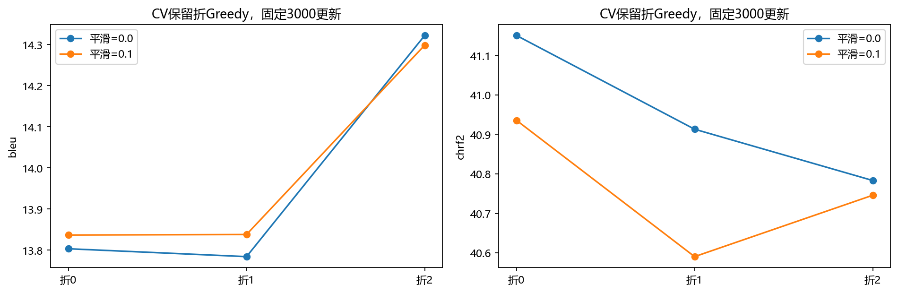
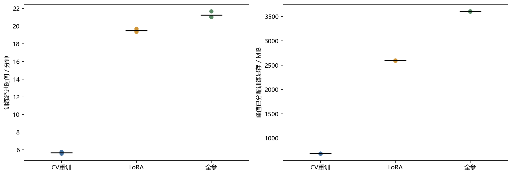
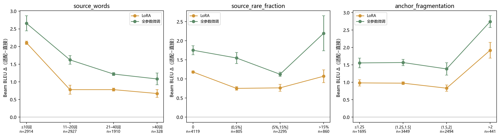

# Grouped CV and same-base adaptation

This page documents the completed 2026-10-28 research extension. It adds parameter-selection evidence and an adaptation quality/cost comparison to the earlier scratch, budget and representation experiments. Selected numerical evidence is in [results/cv_adaptation.json](../results/cv_adaptation.json); fresh execution instructions are in [REPRODUCING_CV_ADAPTATION.md](REPRODUCING_CV_ADAPTATION.md).

## Study questions and scope

1. At a fixed 3,000-update scratch-training budget, does the preference between label smoothing 0 and 0.1 change with the training split?
2. On the same pretrained OPUS-MT base, what quality and resource changes follow LoRA and full fine-tuning?

The study uses the existing pinned IWSLT-17 English→German corpus: 204,285 cleaned training pairs, 888 official validation pairs and 8,079 official test pairs. The test set had already been observed in earlier work. This study froze its settings and selection rules before viewing its new test outputs; that does not turn the public test into an unseen holdout again.

## A. Grouped cross-validation

### Group construction

The original tagged archive was aligned against every one of the 206,112 raw training rows, recovering 1,698 TED talks. Normalized duplicate source sentences and talk membership form a graph; connected components stay intact when assigning three folds. The grouping key uses NFKC, case folding and collapsed whitespace, while retaining punctuation. Translation texts themselves are unchanged.

The recorded split has zero cross-fold talks and zero cross-fold normalized source duplicates. The largest component has 59,843 sentences (29.29% of the cleaned corpus), so balanced row counts cannot ensure identical topic or component distributions.

| Fold | Training pairs before length filtering | Complete held-out pairs |
|---|---:|---:|
| 0 | 136,190 | 68,095 |
| 1 | 136,191 | 68,094 |
| 2 | 136,189 | 68,096 |

### Training and selection

- Fit an independent BPE8k tokenizer on each fold's training portion only.
- Within a fold, compare smoothing 0 and 0.1 using the same tokenizer, seed 42 initialization, sentence order and batch boundaries.
- Train each candidate for 3,000 optimizer updates and evaluate its fixed endpoint. The held-out fold does not choose a checkpoint or early-stopping time.
- Select by arithmetic mean of the three greedy corpus BLEU scores; exact ties use mean chrF2, then the predetermined candidate order.
- Concatenate held-fold predictions in original training-ID order to recompute out-of-fold (OOF) corpus metrics. OOF does not replace the frozen selection rule.

| Smoothing | Mean greedy BLEU ± fold SD | Mean chrF2 ± fold SD | OOF BLEU | OOF chrF2 |
|---|---:|---:|---:|---:|
| 0 | 13.970 ± 0.305 | 40.949 ± 0.186 | 13.966 | 40.946 |
| 0.1 | 13.991 ± 0.266 | 40.757 ± 0.173 | 13.990 | 40.754 |

The selected value is **0.1**, but the mean BLEU difference is only **0.021**. Its fold-wise differences are +0.033382, +0.053786 and −0.023667 BLEU. All three chrF2 differences favor 0. The observed local preferences are split-dependent; the results do not establish stable optimality. Fold SD measures fold differences, with overlapping fold training sets, and is not the sample SD of three independent training seeds.

### Final retraining

After selection, fit a tokenizer on the full cleaned official training set and run three fresh 3,000-update trainings at seeds 42/43/44, again evaluating the fixed endpoint. Full test results are:

| Decoder | BLEU mean ± sample SD | chrF2 mean ± sample SD |
|---|---:|---:|
| Greedy | 15.848 ± 0.079 | 42.024 ± 0.247 |
| Beam | 17.146 ± 0.191 | 42.887 ± 0.299 |

Audited endpoint tensors and aligned test predictions reproduce the corresponding historical models. New training commands, logs and timing establish that fresh training was executed. This is **no additional translation-quality gain**; it supplies a properly grouped selection procedure and a reproducibility result. Historical and new identical-seed results are not pooled into n=6. CV conclusions apply to 3,000 updates, not the older 12,000-update models.

## B. Same-base adaptation

### Fixed base and implementation

- Model: `Helsinki-NLP/opus-mt-en-de`.
- Revision: `6183067f769a302e3861815543b9f312c71b0ca4`.
- Original total parameters: 74,410,496; native tokenizer and special IDs are retained.
- LoRA: r=8, alpha=16, dropout=0, bias none, applied to 36 q_proj/v_proj modules. Implementation is in `mt/adapt_model.py`; PEFT is not a dependency.
- Full fine-tuning updates every learnable base parameter. Native sinusoidal position tables remain non-gradient parameters.

Training-sample probes verified loading, forward/backward passes, optimizer updates, memory and zero-adapter evaluation equivalence. Both methods use effective batch 64, matched microbatch boundaries and the same sentence-ID trajectory within each seed for 3,000 updates, totaling 192,000 sentence exposures. Exposures count repeated presentations, not unique coverage.

### Tuning and checkpoint rules

At tuning seed 7, LoRA compares learning rates 1e-4 and 3e-4; full fine-tuning compares 1e-5 and 3e-5. Each candidate receives 3,000 updates. Complete official-validation greedy scoring runs every 500 updates. Within a run, BLEU, chrF2 and earliest checkpoint determine best; between learning rates, BLEU, chrF2 and predetermined candidate order determine the selection.

Selected learning rates are **3e-4 for LoRA** and **3e-5 for full fine-tuning**. Formal seeds 42/43/44 restart from the original pretrained base instead of continuing tuning checkpoints. Their selected steps are:

| Method | seed42 | seed43 | seed44 |
|---|---:|---:|---:|
| LoRA | 1,500 | 2,000 | 1,000 |
| Full | 3,000 | 3,000 | 3,000 |

Each complete training trajectory matches the paired sentence exposures, but the evaluated best weights have seen different prefixes. Their selected-prefix exposures therefore differ. Reported training costs still include all completed 3,000 steps and separately recorded validation work.

### Full test results

All adaptation evaluations use FP32, native greedy/beam 4, batch 16, max_length=512 including the decoder-start token, length_penalty=1 and forced_eos=0. No validation or test sentence is silently removed or truncated. BLEU is case-sensitive SacreBLEU with tokenizer 13a; chrF2 uses character order 6, word order 0 and beta 2.

| Method | Greedy BLEU | Beam BLEU | Beam chrF2 |
|---|---:|---:|---:|
| Direct inference, fixed base | 31.825 | 32.503 | 59.371 |
| LoRA, three seeds | 32.919 ± 0.084 | 33.450 ± 0.052 | 59.994 ± 0.023 |
| Full fine-tuning, three seeds | 33.436 ± 0.084 | 34.032 ± 0.094 | 60.421 ± 0.042 |

All ± values here are sample SD with ddof=1. The fixed base has one score, not an artificial three-seed SD. LoRA and full fine-tuning gain **0.948 ± 0.052** and **1.530 ± 0.094 Beam BLEU**, respectively. Their within-seed LoRA-minus-full difference is **−0.582 ± 0.064**. Three seeds do not establish statistical significance or universal method superiority.

### Resource measurements

| Quantity | LoRA | Full fine-tuning |
|---|---:|---:|
| Learnable parameters | 294,912 | 73,886,208 |
| Total parameters after adaptation modules | 74,705,408 | 74,410,496 |
| Learnable share | 0.395% | 99.295% |
| Formal training peak allocation | 2,593.5–2,597.3 MiB | 3,603.3–3,606.9 MiB |
| Selected learned-weight file | about 1.16 MiB | about 284.17 MiB |

LoRA's denominator includes the added adapter parameters; the base is frozen. Full fine-tuning retains native non-gradient position tables. The adapter file requires the original base, so its size is not total deployment size. These selected learned-weight exports exclude optimizer recovery state. Training peak allocation is not total GPU usage and is hardware/workload-specific. Evaluation uses unmerged LoRA modules, so parameter efficiency does not imply faster inference.

## Budget, recovery and acceptance

| Stage | Trainings | Net updates | Complete evaluation passes |
|---|---:|---:|---:|
| CV candidates | 6 | 18,000 | 6 |
| Post-selection scratch retraining | 3 | 9,000 | 12 |
| Adaptation learning-rate candidates | 4 | 12,000 | 24 |
| Formal adaptations | 6 | 18,000 | 60 |
| Total | **19** | **57,000** | **102** |

The six complete held-fold evaluations cover 408,570 sentence exposures; their inference cost is part of the study. Separate resource probes recorded 108 optimizer updates. An actual interruption required replaying at least 235 uncommitted updates; known extra computation is retained rather than counted as a new seed or hidden in the net budget. Additional unrecorded work before process loss is unknown.

The original local acceptance record passed **349 regression checks** and preserved **1,393 historical file fingerprints**. This curated public copy does not contain that entire research workspace. Its actual test run and counts are recorded in `RELEASE_CHECKS.json`, separately from GitHub Actions runs. The 349 number is not a promise that every later public suite has exactly 349 tests.

`mt.study` and `mt.study_complete` are historical orchestration/acceptance entry points tied to the original research layout. Fresh users should use the [portable preparation script and lower-level workflow](REPRODUCING_CV_ADAPTATION.md), rather than attempt to supply the original 1,393 historical files.

## Interpretation and public-release boundaries

- The fixed direct-inference predictions and timing were read-only reused after recorded input, model, tokenizer, dependency and generation-configuration checks. Historical `CUBLAS_WORKSPACE_CONFIG` was not recorded; missing evidence establishes neither a mismatch nor exact backend identity. Bitwise backend reproducibility is not claimed.
- OPUS pretraining may overlap with IWSLT/TED. Adaptation does not remove that provenance limitation.
- Official validation selected learning rates/checkpoints; its scores are diagnostic. The limited candidate set and budget constrain generalization.
- Fixed sentence groups preserve the same IDs across methods. Length, rarity and fragmentation associations are confounded, and corpus subgroup BLEU does not decompose additively into overall BLEU.
- Improvements and failures are both retained in agent-assisted sample review. There is no independent human annotation study or measured semantic-error rate.
- GPU execution order, temperature, clocks, power and permitted CPU work were not fully controlled. Timings do not establish causal speed differences.
- Course rubric recognition is for the teaching team to decide; this repository documents the actual grouped CV and adaptation work.

The source repository publishes **source, selected statistics, plots and reproduction instructions**, with no model weights in Git. Separate [v1.1.0 Release assets](https://github.com/lermitto1221/iwslt-en-de-translation/releases/tag/v1.1.0) provide these inference exports:

| Bundle | Selected seed42 update | Single-model test Beam BLEU | Deployment |
|---|---:|---:|---|
| [Full fine-tuning ZIP](https://github.com/lermitto1221/iwslt-en-de-translation/releases/download/v1.1.0/iwslt-en-de-full-seed42-inference-v1.1.0.zip) · [SHA-256](https://github.com/lermitto1221/iwslt-en-de-translation/releases/download/v1.1.0/iwslt-en-de-full-seed42-inference-v1.1.0.zip.sha256) | 3,000 | **33.924** | 277.6 MB ZIP; complete weights included |
| [LoRA ZIP](https://github.com/lermitto1221/iwslt-en-de-translation/releases/download/v1.1.0/iwslt-en-de-lora-seed42-inference-v1.1.0.zip) · [SHA-256](https://github.com/lermitto1221/iwslt-en-de-translation/releases/download/v1.1.0/iwslt-en-de-lora-seed42-inference-v1.1.0.zip.sha256) | 1,500 | **33.402** | 2.34 MB ZIP; fixed original base weight about 298 MB also needed |

Both sizes use decimal MB. Each ZIP includes `translate.py`, `inference.py`, `requirements.txt`, the native tokenizer/configuration, model identity and file checksums. After installing dependencies, the full model supports offline inference. LoRA downloads the exact original base once or accepts its local directory through `--base-model-dir PATH --offline`; the base hash is verified. The adapter is the project's own format, not PEFT. Follow the [standalone CPU demo](../README.md).

The aggregate **33.450 ± 0.052 / 34.032 ± 0.094** values describe three trained seeds, not the individual LoRA/full downloads or an ensemble. Exports reuse existing trained weights. CPU acceptance verifies original-versus-export states, logits and fixed greedy/beam outputs, including effective generation settings; original full-test metrics remain those from the recorded FP32/GPU evaluation. No cross-hardware full-test bitwise claim is made.

Existing [v1.0.0](https://github.com/lermitto1221/iwslt-en-de-translation/releases/tag/v1.0.0) remains the scratch seed42 model scoring **22.889 Beam BLEU**, with its original `mt.translate` interface. Adapted ZIPs use their bundled standalone `translate.py`.
