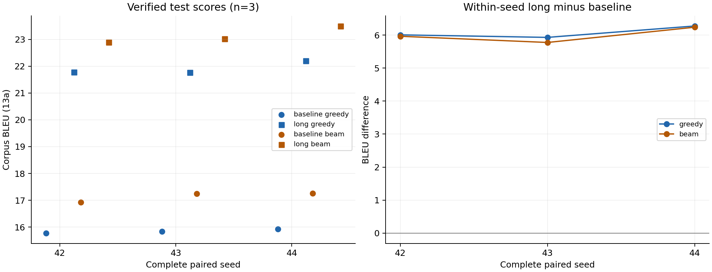
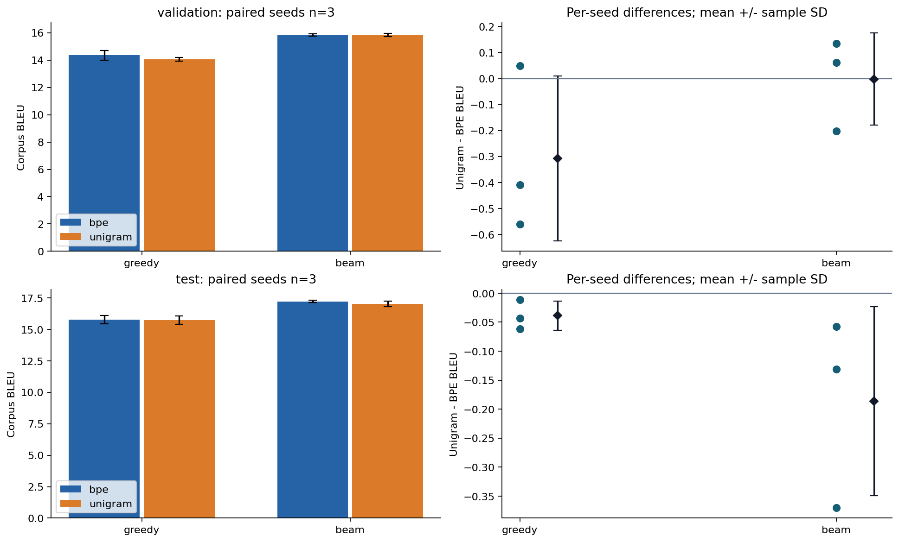
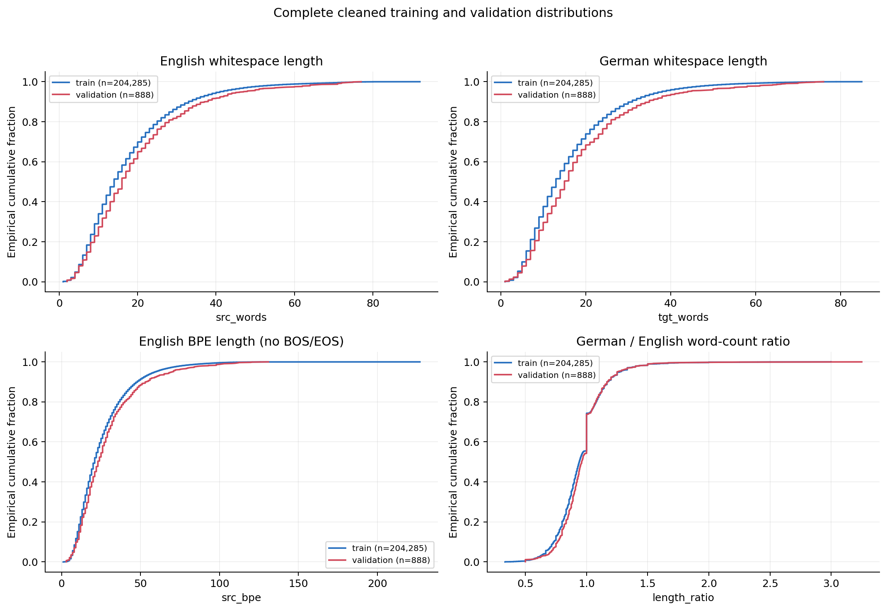
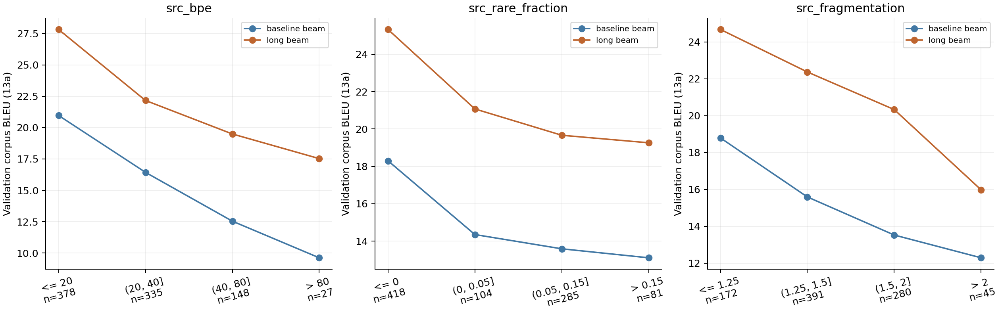

# Results and interpretation

These are selected historical results, not new runs performed while preparing the public copy. Aggregate values are available in [summary.json](../results/summary.json). The source release excludes full corpora, weights and prediction files; rerun the pipelines to obtain a complete machine-local evidence chain.

## Dataset and scoring

The pinned IWSLT-17 English→German source has 206,112/888/8,079 train/validation/test pairs. Training cleaning removes 1,695 duplicate pairs and 132 length-ratio outliers, retaining **204,285 pairs**. The historical training-length filter removes another 139 pairs. Validation and test sentences are retained in full, without silent truncation.

The source is the `iwslt2017-en-de` configuration at revision `3fc158c8125b4d798f2696c0bb5c8928a8fbb332`. The combined test split covers the source release's TED test sets from 2010–2015; scores should not be directly compared with a different IWSLT edition or test subset.

BLEU is case-sensitive SacreBLEU with tokenizer `13a`. chrF2 uses character order 6, word order 0 and beta 2. Statistics across seeds use the sample standard deviation (`ddof=1`), not a confidence interval. Every subgroup score is a corpus metric on its own sentence set, not an average of sentence BLEU scores.

## Historical label-smoothing experiment

Six independent 3,000-update trainings pair label smoothing 0.1 versus 0.0 within seeds 42, 43 and 44. Initial numeric parameters, data, ordering and budgets are matched within each pair. Greedy and beam share each run's validation-best checkpoint.

| Label smoothing | Decoder | Test BLEU, mean ± sample SD |
|---|---|---:|
| 0.1 | Greedy | 15.848 ± 0.079 |
| 0.1 | Beam 4 | 17.146 ± 0.191 |
| 0.0 | Greedy | 15.785 ± 0.163 |
| 0.0 | Beam 4 | 17.050 ± 0.296 |

Beam improves each paired run. Label smoothing has a small mean difference; its greedy effect reverses in seed 44. This does not establish a general or statistically significant advantage.

## Training-budget extension

Three additional fresh trainings extend label-smoothing-0.1 runs from 3,000 to 12,000 updates. Checkpoints are selected by full validation greedy BLEU, retaining the earliest exact tie. The test protocol is fixed to beam 4, length penalty 0.6 and generation cap 256.

| Budget | Greedy BLEU | Beam BLEU | Beam chrF2 |
|---|---:|---:|---:|
| 3,000 updates | 15.848 ± 0.079 | 17.146 ± 0.191 | 42.887 ± 0.299 |
| 12,000 updates | 21.917 ± 0.250 | 23.137 ± 0.321 | 49.778 ± 0.394 |

Within-seed long-minus-short BLEU gains are **6.069 ± 0.181** for greedy and **5.992 ± 0.232** for beam. Historical seed-42 baseline source snapshots are incomplete, and later training versions include persistence/recovery changes. The original comparisons record those differences rather than asserting byte-identical historical training programs. Formal comparison decoders were checked for consistency.

## Controlled subword representations

Six fresh trainings compare BPE8k and unigram8k across the same three seeds. Both tokenizers are fitted only on the same cleaned training corpus. The common length-eligible intersection contains **204,115 pairs**. A shared envelope produces identical original sentence IDs and batch boundaries within a seed, with matched initial numeric weights, update count, learning rate and validation schedule. Actual token counts and computation remain representation-dependent.

| Representation | Greedy BLEU | Beam BLEU | Greedy chrF2 | Beam chrF2 |
|---|---:|---:|---:|---:|
| BPE8k | 15.762 ± 0.329 | 17.222 ± 0.087 | 42.049 ± 0.153 | 42.932 ± 0.208 |
| unigram8k | 15.723 ± 0.337 | 17.036 ± 0.218 | 42.288 ± 0.354 | 43.182 ± 0.329 |

The paired unigram-minus-BPE beam difference is **−0.186 ± 0.163 BLEU** and **+0.250 ± 0.373 chrF2**. All three BLEU differences are negative, while chrF2 directions vary by seed. Neither representation is uniformly better under both metrics. The inherited decoder was selected on historical BPE validation results; these are shared-protocol results, not individually optimized decoder comparisons.

## External pretrained reference

`Helsinki-NLP/opus-mt-en-de`, revision `6183067f769a302e3861815543b9f312c71b0ca4`, is evaluated with its native tokenizer and a frozen native generation procedure. It has **74,410,496 parameters**, versus 11,681,600 in the scratch Transformer. The project performs **zero training or adaptation updates** on this model.

| Native decoder | Test BLEU | Test chrF2 |
|---|---:|---:|
| Greedy | 31.825 | 58.458 |
| Beam 4 | 32.503 | 59.371 |

Its pretraining data, size, vocabulary and decoder differ. The available provenance does not rule out overlap with IWSLT/TED evaluation material. The result therefore compares complete methods, not architecture alone or equal training budgets. One beam test output reached the generation limit with repetition; forced EOS does not imply the translation succeeded. LoRA was not performed.

## Data and group diagnostics

Training-frequency definitions use whitespace tokens with case-folding and retained punctuation. Validation unseen-token rates are 2.14% in English and 4.07% in German; these are **not SentencePiece UNK rates**.

Fixed same-sentence groups expose quality differences. In the controlled 3,000-update BPE experiment, beam BLEU is 21.662 for source sentences of at most 10 whitespace words and 13.557 for sentences over 40 words. Corresponding low/high fragmentation groups score 20.353/14.003. These associations include multiple confounders; they are not isolated causal effects.

Exploratory sentence-vector analysis fits standardization, PCA50 and KMeans5 on 10,000 training vectors only, then assigns the 888 validation sentences. PCA50 explains 85.71% of variance. Silhouette is 0.0462, and validation source-BPE length has cluster association η²=0.729. The clusters overlap substantially and mainly track length; they are not validated semantic themes.

Validation scores in this exploration are diagnostic because validation was already used for checkpoint and decoding choices. Fixed sample review records both improvements and failures, including omissions, entity substitutions, repetition and negation reversal. It is agent-assisted review, not independent human annotation or a measured overall error rate.

## Reliability and remaining limitations

The historical final suite passed **194 regression tests**, spanning data/tokenizer integrity, checkpoint recovery, decoding/metric checks, and plan freezing/result reuse. The original execution audited 518 pre-existing files as unchanged. Those are historical observations, not a statement that all original evidence is included here or that another machine has passed the suite.

- Fifteen scratch trainings comprise six label-smoothing runs, three budget extensions and six representation runs. Diagnostic smoke/overfit runs are excluded from this count.
- Three seeds on fixed splits are not k-fold cross-validation. CV and LoRA remain unperformed.
- The public test set has been observed across successive experiments. Freezing a later experiment prevents its own result-driven changes but does not make the public test set a previously unseen holdout again.
- Runtime measurements span dates and were not fully controlled for power, temperature and clocks. Batch-amortized time is not isolated single-request latency.
- Cross-hardware bitwise reproducibility, convergence and universal translation correctness are not established.
